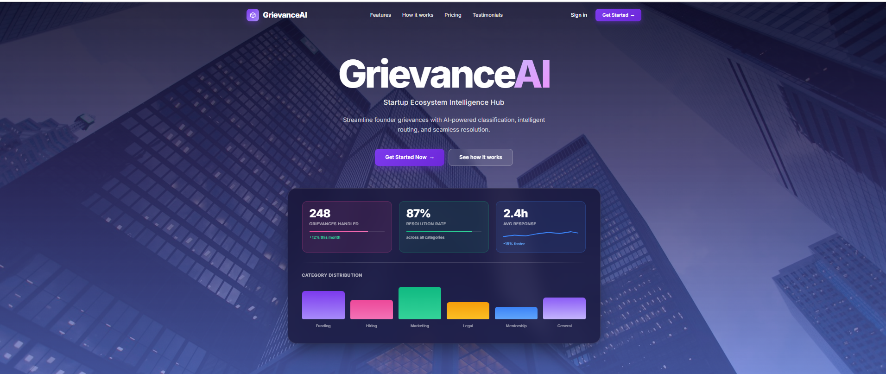
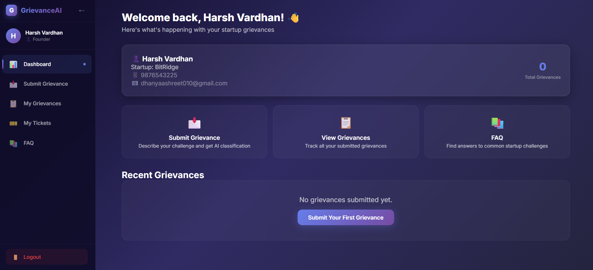
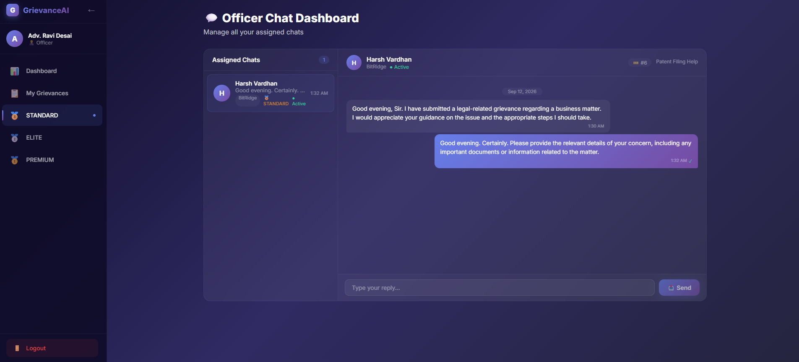
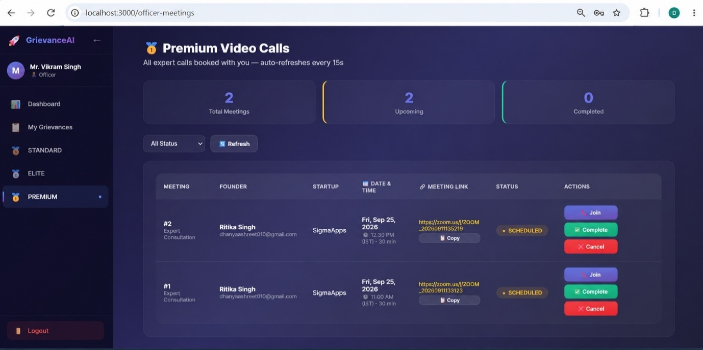
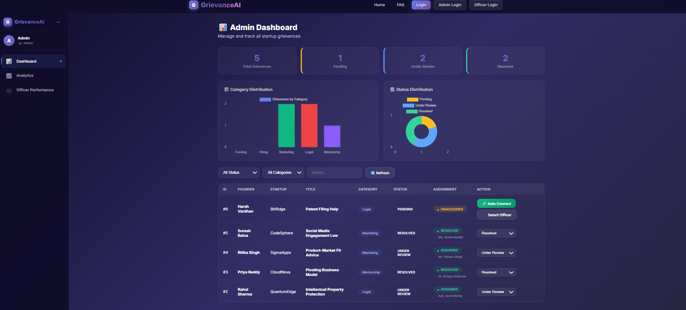
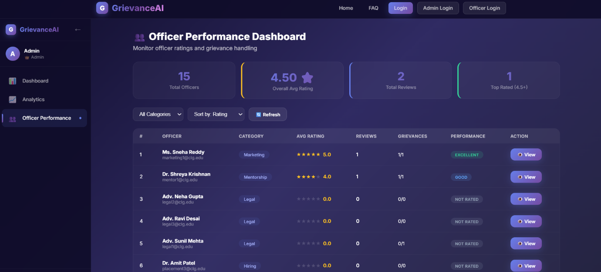
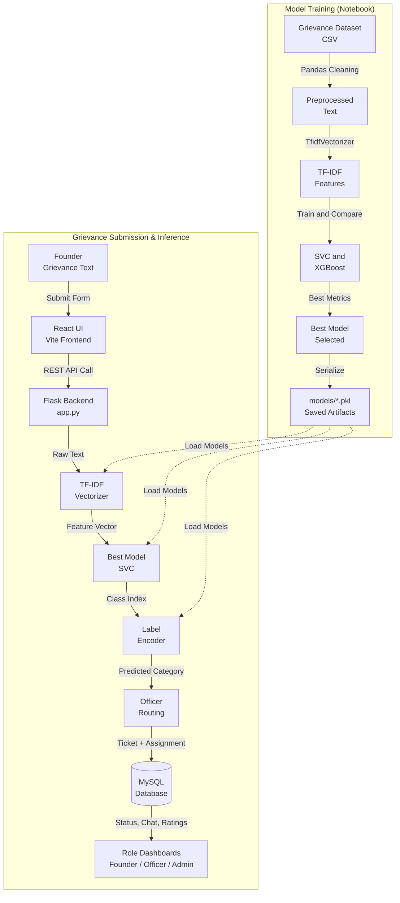
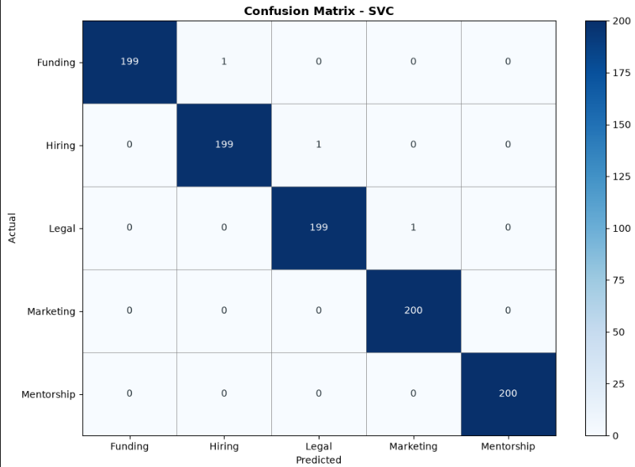
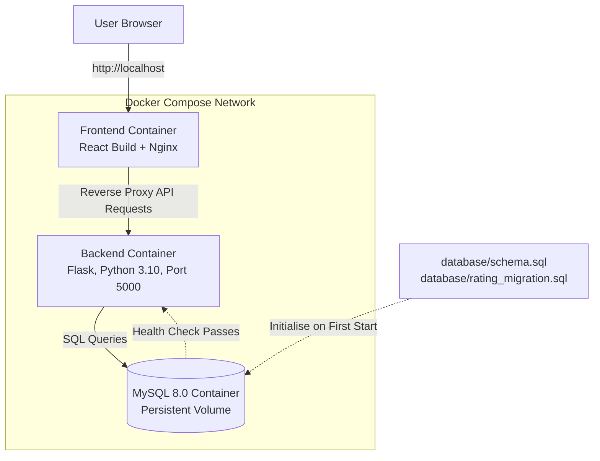

<div align="center">

# GrievanceAI: Startup Ecosystem Hub

**An AI-powered grievance management platform that classifies, routes, and resolves startup founders' concerns, with tiered support and officer analytics.**


</div>

---

## Table of Contents

- [Overview](#overview)
- [Key Features](#key-features)
- [Screenshots](#screenshots)
- [System Architecture](#system-architecture)
- [User Roles and Modules](#user-roles-and-modules)
- [Tech Stack](#tech-stack)
- [Project Structure](#project-structure)
- [Database Design](#database-design)
- [Machine Learning Pipeline](#machine-learning-pipeline)
- [Model Performance](#model-performance)
- [Docker Deployment](#docker-deployment)
- [Getting Started](#getting-started)
- [Testing](#testing)
- [Author](#author)
- [License](#license)

---

## Overview

Startup founders in incubator ecosystems usually raise grievances through emails, support forms, or direct conversations. Each one is then read, categorised, and assigned by hand, which causes delays, gives founders little visibility, and leaves administrators without data on how well support is working.

**GrievanceAI** replaces this manual process with a secure, trackable, and intelligent workflow:

1. An authorised founder registers through a **whitelist** and **email OTP**, then submits a grievance.
2. **TF-IDF** features and a trained **SVC / XGBoost** classifier assign one of five categories automatically.
3. The grievance is **routed to the officer** responsible for that category.
4. The founder tracks progress and gets support through a **tiered service** (chat, document upload, or booked calls).
5. After resolution the founder **rates the officer**, and administrators monitor **performance analytics**.

### Why it matters

| Manual process | With GrievanceAI |
|---|---|
| Manual categorisation | Automatic ML classification |
| Slow, uneven assignment | Category-based officer routing |
| No visibility for founders | Real-time status tracking and activity log |
| No accountability data | Ratings, resolution time, and officer analytics |
| One-size-fits-all support | Standard, Elite, and Premium tiers |

---

## Key Features

| Area | Capability |
|---|---|
| **Secure access** | Whitelist-based registration, email OTP verification, role-based access for Admin, Officer, and Founder |
| **AI classification** | TF-IDF text features with SVC and XGBoost, compared to select the best model (SVC: 99.70% accuracy) |
| **Categories** | Funding, Hiring, Legal, Marketing, Mentorship |
| **Officer routing** | Automatic assignment of grievances based on predicted category |
| **Ticket tracking** | Status lifecycle (Assigned, In Progress, Resolved) with a ticket activity log |
| **Standard tier** | Real-time chat between founder and officer |
| **Elite tier** | Document upload with preview and officer review |
| **Premium tier** | Calendar and time-slot booking for call appointments with meeting confirmation |
| **Feedback** | Star ratings and reviews for officers after resolution |
| **Analytics** | Per-officer performance: grievances handled, resolution time, status, and ratings |

---

## Screenshots

<table>
  <tr>
    <td align="center"><br/><sub><b>Home Page</b></sub></td>
    <td align="center"><br/><sub><b>Founder Dashboard</b></sub></td>
  </tr>
  <tr>
    <td align="center"><br/><sub><b>Officer Chat (Standard Tier)</b></sub></td>
    <td align="center"><br/><sub><b>Premium Video Calls</b></sub></td>
  </tr>
  <tr>
    <td align="center"><br/><sub><b>Admin Dashboard</b></sub></td>
    <td align="center"><br/><sub><b>Officer Performance Analytics</b></sub></td>
  </tr>
</table>

---

## System Architecture



The top block shows the live request path. The bottom block shows the offline training workflow that produces the three serialised artifacts (`tfidf_vectorizer.pkl`, `best_model.pkl`, `label_encoder.pkl`) loaded by the backend.

---

## User Roles and Modules

### Founder
Dashboard, grievance submission, **My Grievances / My Tickets**, chat with officer, document upload, premium meeting booking (**My Meetings**), and officer rating through a rating modal.

### Officer
Dashboard, assigned grievances with detail view, status updates and resolution details, chat with founders, Elite document review, meeting schedule, and personal performance view.

### Administrator
Dashboard with key counts, founder and officer management, grievance monitoring and assignment, category and service-tier management, officer performance analytics, and report generation.

### Authentication and Service
Whitelist registration, email OTP, role-based route protection, and tier-based access to chat, uploads, and appointment booking.

---

## Tech Stack

| Layer | Technology |
|---|---|
| Frontend | React (Vite), JavaScript, CSS |
| Backend | Python, Flask |
| Database | MySQL |
| Machine Learning | scikit-learn, XGBoost, Pandas, NumPy |
| Experimentation | Jupyter Notebook |
| Containerisation | Docker, Docker Compose |
| Web Server | Nginx (static hosting and API reverse proxy) |
| Tools | Visual Studio Code, XAMPP |

---

## Project Structure

```
GrievanceAI/
├── backend/
│   ├── app.py                     # Flask application and API routes
│   ├── Dockerfile                 # Backend image (Python 3.10)
│   ├── .dockerignore              # Files excluded from the backend build
│   ├── requirements.txt           # Python dependencies
│   ├── models/
│   │   ├── best_model.pkl         # Selected classifier
│   │   ├── label_encoder.pkl      # Category encoder
│   │   └── tfidf_vectorizer.pkl   # Fitted TF-IDF vectorizer
│   └── uploads/                   # Founder-uploaded documents
├── data/
│   └── GrievanceAI_Industry_Grade_5000.csv   # Training dataset
├── database/
│   ├── schema.sql                 # Database schema and initial data
│   └── rating_migration.sql       # Officer rating migration
├── frontend/
│   ├── Dockerfile                 # Multi-stage build: React build, then Nginx
│   ├── nginx.conf                 # Frontend routing and API reverse proxy
│   ├── index.html
│   ├── package.json
│   ├── vite.config.js
│   └── src/
│       ├── App.jsx, main.jsx, index.css
│       ├── api.js                 # Central API configuration (relative URLs)
│       ├── AdminDashboard.jsx
│       ├── OfficerLogin.jsx, OfficerDashboard.jsx, OfficerGrievances.jsx,
│       │   OfficerDetail.jsx, OfficerChat.jsx, OfficerEliteReview.jsx,
│       │   OfficerMeetings.jsx, OfficerPerformance.jsx
│       ├── MyGrievances.jsx, MyTickets.jsx, MyMeetings.jsx
│       ├── FounderChat.jsx, EliteChat.jsx
│       ├── DocumentUpload.jsx, DocumentPreview.jsx
│       ├── PremiumBooking.jsx, CalendarWidget.jsx, TimeSlotPicker.jsx,
│       │   MeetingConfirmation.jsx, PaymentPage.jsx
│       └── RatingModal.jsx, StarDisplay.jsx, TicketServiceModal.jsx
├── docs/
│   ├── confusion_matrix_svc.png   # Model evaluation
│   └── screenshots/               # Application screenshots
├── Notebook/
│   └── GrievanceAI.ipynb          # Data preparation, training, evaluation
├── docker-compose.yml             # Frontend, backend, and MySQL services
├── .env                           # Local configuration (git-ignored)
├── .gitignore
└── setup.bat                      # Windows setup script
```

---

## Model Performance

Both models were trained on the grievance dataset (about 5,000 records) and evaluated on a held-out test set of 1,000 samples (200 per category).

| Model | Test Accuracy |
|---|---|
| **SVC (selected)** | **99.70%** |
| XGBoost | 96.20% |

**Per-class results (precision / recall / F1)**

| Category | SVC | XGBoost |
|---|---|---|
| Funding | 1.00 / 1.00 / 1.00 | 0.95 / 0.96 / 0.96 |
| Hiring | 0.99 / 0.99 / 0.99 | 0.91 / 0.97 / 0.94 |
| Legal | 1.00 / 0.99 / 1.00 | 0.97 / 0.98 / 0.97 |
| Marketing | 1.00 / 1.00 / 1.00 | 1.00 / 0.97 / 0.98 |
| Mentorship | 0.99 / 0.99 / 0.99 | 0.99 / 0.93 / 0.96 |
| **Macro average** | **1.00 / 1.00 / 1.00** | **0.96 / 0.96 / 0.96** |

**Confusion matrix (SVC)**



Only 3 of 1,000 test samples were misclassified by SVC (one each in Funding, Hiring, and Legal), so SVC was chosen as the production model and saved as `backend/models/best_model.pkl`.

---

## Docker Deployment

The application is fully containerised with Docker Compose and runs as three services on a shared internal network.



| Service | Details |
|---|---|
| **Frontend** | React app built with a multi-stage Dockerfile and served by Nginx. Nginx also forwards API requests to the Flask backend, and the frontend uses relative API URLs instead of a hardcoded `localhost` backend. |
| **Backend** | Flask on Python 3.10. Installs from `backend/requirements.txt` and exposes port 5000 only inside the Docker network. |
| **Database** | MySQL 8.0 with a persistent Docker volume. Initialised from the SQL scripts in `database/`. A health check ensures the backend starts only after the database is healthy. |

| File | Purpose |
|---|---|
| `docker-compose.yml` | Defines and manages the frontend, backend, and MySQL services |
| `frontend/Dockerfile` | Builds the React app and serves it through Nginx |
| `frontend/nginx.conf` | Frontend routing and backend API reverse proxy |
| `backend/Dockerfile` | Builds the Flask backend image |
| `backend/.dockerignore` | Excludes unnecessary files from the backend build |
| `database/schema.sql`, `database/rating_migration.sql` | Schema, initial data, and officer rating migration |

> **Status:** verified locally with Docker Compose (all three containers running, MySQL healthy, frontend served at `http://localhost`, API requests proxied to Flask). This is a local Docker deployment, not a public cloud deployment.

---

## Database Design

Nine core tables back the platform:

| Table | Purpose |
|---|---|
| `founder` | Registered founder accounts |
| `whitelist_numbers` | Authorised users and officer records |
| `grievances` | Submitted grievances and predicted category |
| `grievance_assignments` | Grievance-to-officer routing |
| `ticket_activity_log` | Status history for each ticket |
| `chat_messages` | Standard tier chat |
| `elite_documents` | Elite tier document uploads |
| `premium_meetings` | Premium tier call appointments |
| `officer_ratings` | Founder ratings and feedback |

---

## Machine Learning Pipeline

1. **Load and clean** the grievance dataset with Pandas and NumPy.
2. **Vectorise** the text with TF-IDF.
3. **Train** SVC (Support Vector Classifier) and XGBoost classifiers.
4. **Evaluate** both with standard classification metrics and keep the better model.
5. **Serialise** the vectorizer, model, and label encoder into `backend/models/`.
6. **Serve** predictions from Flask at grievance submission time.

Full experimentation is documented in `Notebook/GrievanceAI.ipynb`.

---

## Getting Started

### Prerequisites

- [Docker](https://www.docker.com/) and Docker Compose (recommended), **or**
- Python 3.10, Node.js and npm, and MySQL (for manual setup)
- An email account with an app password for sending OTPs

### 1. Clone

```bash
git clone https://github.com/Dhanyaa-shree/GrievanceAI-Startup-Ecosystem-Hub.git
cd GrievanceAI-Startup-Ecosystem-Hub
```

### 2. Configure

Create a `.env` file in the project root (never commit this file):

```env
DB_HOST=your_db_host
DB_USER=your_user
DB_PASSWORD=your_password
DB_NAME=your_database
SECRET_KEY=your_secret_key
MAIL_USERNAME=your_email
MAIL_PASSWORD=your_app_password
```

### Option A: Docker (recommended)

```bash
docker compose up --build
```

Then open **http://localhost** in your browser. The database is created and initialised automatically, and the backend starts once MySQL reports healthy.

Useful commands:

```bash
docker compose ps          # check container status
docker compose logs -f     # follow logs
docker compose down        # stop containers (data volume is kept)
docker compose down -v     # stop and delete the database volume
```

### Option B: Manual setup

**Database**

```bash
mysql -u <user> -p <database_name> < database/schema.sql
mysql -u <user> -p <database_name> < database/rating_migration.sql
```

**Backend**

```bash
cd backend
python -m venv env
env\Scripts\activate
pip install -r requirements.txt
python app.py
```

**Frontend**

```bash
cd frontend
npm install
npm run dev
```

> On Windows, `setup.bat` automates the dependency installation steps.

---

## Testing

The system was verified through unit, integration, functional, system, and acceptance testing, including:

- Login and registration input validation (empty fields, invalid email, invalid mobile number)
- OTP generation, delivery, acceptance, and expiry handling
- Grievance submission and category classification
- Status updates through the ticket lifecycle
- Rating and feedback submission after resolution

---

## Author

**Dhanyaa Shree**

[](https://github.com/Dhanyaa-shree)
[](https://www.linkedin.com/in/dhanyaa-shree/)

---

## License

Distributed under the MIT License. See [`LICENSE`](LICENSE) for details.

<div align="center">

If you found this project useful, consider giving it a star.

</div>
